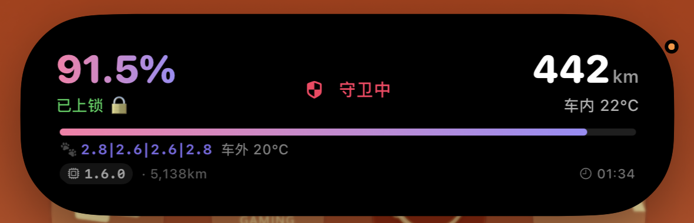
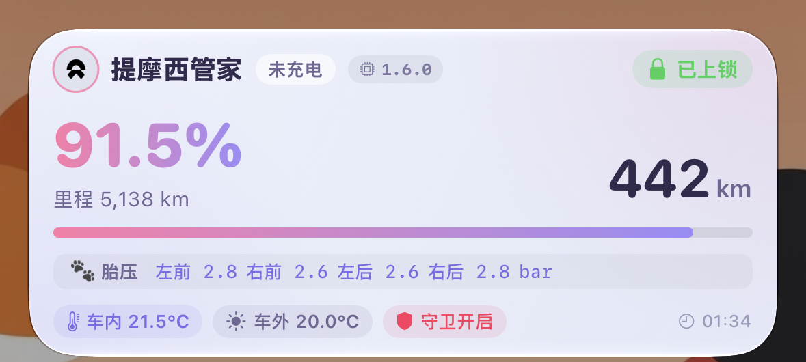

<h1 align="center">🐰 YumikoToysRR for NIO (iOS)</h1>

<p align="center">
  
  <br>
  
</p>

<p align="center">
  <strong>专为蔚来车主打造的二次元萌动艺术风车况看板 · 灵动岛 (Dynamic Island) 与锁屏实时活动 (Live Activity) 智能助理</strong>
</p>

<p align="center">
  
  
  
  
  
  
</p>

---

## ✨ 核心功能矩阵（27 大全景车况与服务系统）

### 1. 🔋 动力电池与高压快充大屏
- **全维高压大电池诊断**：实时剩余电量（SOC）、标称与实估续航里程、总里程、达成率动态能量条。
- **⚡️ 高压快充详情大屏**：实时充电功率（kW）、充电电流（A）、充电电压（V）、目标限充百分比、充满预估时间倒计时、充电桩类型自动辨识（交流慢充 / 直流快充 / 超充桩 / 换电站充电机 / V2L 对外放电）。

### 2. 🪟 车门、车窗与全景天幕透视
- **车门门锁透视**：4 门独立开闭状态、全车防盗锁、前机舱盖、电动尾门、充电口盖状态。
- **车窗与天窗开度**：4 门车窗独立开度百分比（0-100% 动态能量条）、全景天窗天幕开度、后视镜折叠状态感知。

### 3. 🚗 驾驶模式与行车泊车全景
- **驾驶模式全维感知**：舒适、节能、运动、运动+、个性化、雪地、沙地、湿地模式，驻车时智能提示「上次设定模式」。
- **车辆挡位与泊车状态**：实时车速、P/D/R 挡位、遥控泊车辅助（RPA）进行中与待命状态、行程分享状态。

### 4. 🛞 四轮胎压、温度与 12V 小电瓶
- **4 轮胎压与胎温监测**：四轮独立压温网格、冷车推荐气压、胎压告警与休眠智能继承。
- **🔑 智能钥匙与 12V 低压蓄电池**：12V 辅助电瓶实时精准电压（如 `12.8V 优良`）、电瓶健康度评级、蓝牙靠近感应、感应门把手伸出状态。

### 5. 🌡️ 座舱温湿度、舒适与空气健康
- **温暖座舱与空调干燥**：车内外双温差显示、空调运行状态、高温超强干燥、极速除霜、极速冷热、座舱过热保护。
- **🪑 座椅舒适与方向盘加热**：方向盘加热档位、4 座独立加热与通风档位、动力电池预热与保温状态。
- **🧊 车载智能冰箱与空气健康**：车载冰箱电源与当前/目标温度、PM2.5 车内外空气质量检测。
- **📦 储物空间与行李箱状态**：前机舱盖/前备箱开闭、电动尾门/后备箱开闭、中控密码手套箱上锁状态。
- **💡 车外灯光与照明系统**：近光灯、远光灯、示宽灯、双闪危险警报灯拟物化语义展示。

### 6. 📍 高精位置、地图导航与行车轨迹回放
- **高精停车位置与纠偏**：WGS-84 地球坐标转 GCJ-02 高精纠偏，一键调起高德地图 / 百度地图 / Apple 地图导航寻车。
- **🗺️ 历史行驶轨迹地图**：当日行驶轨迹连线渲染、起点终点标记、行驶距离统计与时间轴回放。

### 7. 🛡️ 守卫模式与远程车控
- **特殊驻车模式**：守卫模式（Sentry）、宠物模式、露营模式、离车不下电、车机在线/离线状态。
- **⚡️ 远程智能车控**：闪灯鸣笛寻车、远程开闭空调、车锁解锁/上锁、极速除霜干燥。

### 8. 📑 换电站足迹与财务大屏
- **换电大屏**：累计换电次数、总花费支出、常用换电站 Top 排行榜。
- **服务工单手风琴**：最近换电与维保订单列表，支持一键展开查看服务站地址、工单号、支付明细。

### 9. 📈 能耗达成率与多维趋势图表
- **百公里电耗评分**：达成率动态计算、推算百公里电耗（kWh/100km）能耗评分。
- **📊 趋势图表分析**：每日里程增量柱状图、电池容量衰减健康曲线、历史快照趋势。

### 10. 🔧 维保周期与签到成就
- **维保耗材寿命**：空调滤芯、刹车油、齿轮箱油等耗材寿命倒计时天数与剩余公里数。
- **📅 签到连击与里程成就**：自动签到、连续签到天数、积分累积统计、里程成就勋章。

### 11. 🔍 诊断、日志与底层 JSON 检视
- **📜 抓包请求与运行日志**：请求历史列表、URL、状态码、响应耗时（ms）、一键复制 cURL/JSON。
- **底层 JSON 实时检视**：每张卡片右上角配备 `{ }` 按钮，一键弹出查看底层 RVS 数据结构并支持一键复制。

### 12. 🎨 萌系动漫艺术风与个性化
- **车型与涂装定制**：ET5 / ET5T / ET7 / ES6 / EC6 / ES8 / ET9 等各车型与多款官方专属车漆。
- **二次元主题系统**：樱花粉、薄荷青、薰衣草紫、暖阳黄等 6 套主题色，支持粒子特效与省电模式。

### 13. 📱 灵动岛 (Dynamic Island) 与实时活动 (Live Activity)
- 息屏/锁屏即时查看电量、续航、车锁状态、充电功率与充满倒计时；
- 展开区直观呈现 4 轮胎压、车内外温差、车载冰箱、守卫模式告警与车机固件版本胶囊；
- **紧凑岛防裁切适配（v5.1.0）**：左侧纯图标（充电⚡ / 低电橙 / 主题色电量）+ 右侧 SOC 百分比，全机型灵动岛胶囊不再被挖孔截断。

### 14. 🖥️ iPad / Duo 折叠屏全面适配（v5.1.0）
- **特斯拉式侧边栏**：8 大功能分类（概览 / 车辆详情 / 模式与外设 / 能量与能耗 / 轮胎与位置 / 趋势与轨迹 / 维保与记录 / 同步诊断），侧栏底部常驻连接状态；
- **形态自适应**：Duo 折叠态单列手机布局 ↔ 展开态 ≥780pt 自动双列卡片流，看板与设置页均支持；
- **大屏全屏呈现**：设置 / 关于 / 更新日志 / 诊断日志在 regular 宽度用全屏页替代 640pt 死宽 sheet；
- **自定义折叠按钮**：主题色小圆钮 + 淡色标题条，替换系统玻璃大按钮；iPhone 14 Pro 等小屏完全不受影响。

### 15. 🌸 三风格启动动画与主页车图（v5.0.0+）
- **能量充能**（默认）：电池环 0→100% 充能 + 数字滚动 + 电弧凝聚 Logo + 星尘上浮 / 轨道电子 / 冲击波 / Logo 光泽扫过，全套主题联动；
- **像素重制**：15×15 像素点阵波次点亮 → 高清 Logo；**极简快启**：≤1.1s 淡入，省电动效下自动强制；
- 设置页可切换风格 / 节奏 / 每日一次 / 触感反馈，支持一键预览；
- **主页车型图片**：内置 ET5 官图（Vision 原生抠图 + 展台辉光）/ 相册导入 / 纯渐变三模式，标题跟随所选车型。

---

## 📜 更新日志

### v5.1.0 (Build 2701) · 2026-10
- 🪞 灵动岛紧凑区重构：左图标 + 右 SOC 数字，适配全机型胶囊宽度
- 📱 Duo 折叠屏与 iPad 全面适配：侧边栏 / 双列 / 全屏页 / 自定义折叠钮
- 🛠 特殊模式识别修复（宠物 / 露营 / 不下电键名对齐真实 RVS）、外设卡语义化、位置卡叠印修复
- 🖼 主页车型标题跟随设置 + Vision 抠图车图展台光
- 🔑 统一设备指纹（User-Guid / app_ver / UA），防服务器多端误判踢线；抓包链路全同步
- 🔁 凭证接收去重：相同凭证重复推送静默忽略，不再反复震动

### v5.0.0 (Build 2700) · 2026-10
- 🚀 iOS 26 基线（部署目标 16.1 → 26.0）
- 🌸 三风格启动动画（能量充能 / 像素重制 / 极简快启）+ 设置项
- 📊 看板六张新卡：特殊模式、智能外设、能耗评分、历史趋势（Swift Charts）、维保追踪、今日行驶轨迹（MapPolyline）
- 📦 换电/维保订单本地持久化，冷启动即有数据；空响应保护，接口抖动不清屏

---

## 🔄 双引擎数据获取与自动容灾体系

```
                    ┌───────────────────────────────────────────┐
                    │            用户配置 / 数据拉取触发           │
                    └─────────────────────┬─────────────────────┘
                                          │
                   ┌──────────────────────┴──────────────────────┐
                   ▼                                             ▼
       【模式 A：Shadowrocket 抓包模式】              【模式 B：Widget 动态签名模式】
        (icar.nio.com 全量 RVS 数据源)                 (app.nio.com 小组件轻量数据源)
                   │                                             │
      包含全部 24 个深度状态块:                               包含 6-8 个核心基础状态块:
      • 12V 小电瓶电压/健康度                                  • 高压电量 SoC / 续航里程
      • 智能钥匙/蓝牙靠近感应                                  • 4 门开闭与整车车锁
      • 座椅通风加热/方向盘加热                                • 车辆实时位置 GPS
      • 4 门车窗天幕独立开度                                   • 胎压与基本状态
      • 车载冰箱/储物箱/车外灯光                                         │
                   │                                                     │
                   ▼                                                     ▼
      ┌─────────────────────────┐                           ┌─────────────────────────┐
      │  每次抓包捕获全量数据包   │                           │  动态计算 Sign，永不过期  │
      │  自动触发 7 大缓存落盘   │                           │  日常高频轮询，安全稳定  │
      └────────────┬────────────┘                           └────────────┬────────────┘
                   │                                                     │
                   └──────────────────────┬──────────────────────────────┘
                                          ▼
                   ┌───────────────────────────────────────────┐
                   │       ⚡️ 智能数据继承与融合渲染引擎       │
                   │ (当 Widget 模式缺少小电瓶/座椅/车窗等块时，  │
                   │  自动无缝继承并渲染本地缓存中的真实有效数据)  │
                   └───────────────────────────────────────────┘
```

- **7 大高级数据本地持久化继承**：`cached-tyre.json`、`cached-lv-batt.json`、`cached-key.json`、`cached-heating.json`、`cached-window.json`、`cached-frdg.json`、`cached-box.json`、`cached-light.json`。
- 即使在日常使用 Widget 动态签名模式下，小电瓶、座椅加热、车窗开度等数据也始终保持最新状态，绝不空白！

---

## 📱 凭证抓包与配置指引（三条链路，全部支持自动回填）

> 🔑 **防多端登录踢 Token（v5.1.0）**：三条链路均自动捕获设备指纹（`User-Guid` / `app_ver` / `User-Agent`），
> App 回放五类请求时与真机同源，服务器不再把回放判定为多端登录。UA 策略：主 App 指纹优先，Widget 指纹仅兜底。

### 链路一：Shadowrocket 模块直推（推荐日常使用）
1. 添加模块 `scripts/shadowrocket/YumikoToys-NIO.sgmodule`（v2.3.0+，模块详情可查看 `#!version` 确认最新），开启 HTTPS 解密；
2. iPhone 上打开 YumikoToys → 设置 → 蔚来看板 → 开启 **TCP 转发**（监听 127.0.0.1:8997）；
3. 打开 **蔚来 App** 下拉刷新一次——小火箭自动捕获 Token / 车辆 ID / 设备指纹并**直推回填**，App 弹「已回填」即完成；
4. Token 过期时（蔚来 App 刷新一次）会自动推送新 Token，**无感续命**；相同凭证重复推送会被 App 静默去重，不反复震动。

### 链路二：Mac 抓包助手 sniff.sh（备胎 / 全量 JSON）
1. Mac 运行 `./sniff.sh iphone`（需 `brew install mitmproxy`），按提示给 iPhone 配 Wi-Fi 代理 8080 并信任 mitmproxy 证书；
2. iPhone 上先开 YumikoToys 的 TCP 转发并保持前台，再打开蔚来 App 下拉刷新；
3. 抓到核心凭证后**自动直推回 iPhone**（与链路一同协议），JSON 同时落盘 `nio_sniff_result.json` 并复制剪贴板；
4. 直推失败时，把剪贴板 JSON 直接粘进 App「⚡️ 智能填充」——自动清洗反引号 / 伪 token 数组等杂质。

### 链路三：Widget 动态签名模式（免抓包长期模式）
1. 在 App 设置中填入 **Vehicle ID**、**Device ID** 与 **Sign Secret**；
2. 应用每次请求动态计算 MD5 时间戳签名，**永不过期**，适合不想频繁抓包的场景（数据块比 RVS 全量模式少，缺失块自动继承本地缓存）。

### Token 捕获差异速查
| 字段 | Shadowrocket | sniff.sh (mitmproxy) |
|---|---|---|
| Token / 车辆 ID / device_id / sign / RVS URL | ✅ | ✅ |
| 设备指纹三件套（app_ver / UA / User-Guid） | ✅ | ✅ |
| 换电 / 签到接口 | ✅ | ✅ |
| refresh_token / sign_secret / Token 续期（响应体） | ❌（请求型脚本无响应体） | ✅ |

> SR 链路自洽：refresh_token App 不使用；sign_secret 仅 Widget 动态签名模式需要（可手动填写或跑一次 sniff.sh 补上）；Token 续期由「蔚来 App 刷新 → SR 抓新 Token → 直推」完成。

---

## 📦 安装说明 (Installation)

### 方式一：下载 Release 预编译 IPA（推荐）
1. 前往 GitHub [Releases](../../releases) 页面，下载最新的 `YumikoToysRR-unsigned.ipa`；
2. 使用 **TrollStore（巨魔商店）**、**Sideloadly**、**AltStore** 或个人证书直接签名安装；
3. 自带灵动岛与锁屏实时活动扩展插件 (`WheaterStatusExtension.appex`)。

### 方式二：Xcode 源码编译
1. 克隆本仓库：
   ```bash
   git clone https://github.com/kissggj123/NIO-Dash-iOS.git
   cd NIO-Dash-iOS
   ```
2. 使用 Xcode 打开 `YumikoToysRR.xcodeproj`；
3. 在 `Signing & Capabilities` 中配置您的开发者账号证书，选择真机运行安装即可。

---

## 🌲 项目结构 (Directory Tree)

```text
YumikoToysRR-Weather/
├── WheaterStatus/                      # 灵动岛 (Dynamic Island) 与锁屏实时活动 Widget 扩展
│   ├── WheaterStatus.swift             # 实时活动 UI 渲染（紧凑岛、展开岛、锁屏大卡片）
│   ├── WheaterStatus.intentdefinition  # WidgetKit 意图配置
│   ├── Info.plist                      # Widget 扩展权限配置
│   └── Assets.xcassets                 # 小组件专属素材与颜色令牌
├── wheater/                            # iOS 主应用程序源码
│   ├── Model/                          # 数据模型与核心算法库
│   │   ├── NIO/
│   │   │   ├── NIOModels.swift         # 蔚来 API 数据结构定义 (SOC/车门/空调/胎压/维保/充电/车窗/冰箱等)
│   │   │   ├── NIOVehicleLib.swift     # 电池容量推算、坐标纠偏、达成率算法、动态重签名引擎与主题令牌
│   │   │   ├── NIOOrderLib.swift       # 换电/维保订单账单与常用换电站排行解析库
│   │   │   └── NIOCheckinLib.swift     # 车主每日签到与积分统计
│   │   └── WheaterAttributes.swift     # 跨进程 Live Activity 数据通信契约与指纹去重
│   ├── ViewModel/                      # 业务逻辑与网络服务
│   │   └── NIOService.swift            # 蔚来双引擎通信协议、7大状态块持久化继承、后台轮询、灵动岛生命周期
│   ├── Views/                          # SwiftUI 视图组件层
│   │   ├── NIO/
│   │   │   ├── IOSNIODashboardView.swift    # 蔚来 27 大全景车况主看板（iPhone 分段器 / iPad·Duo 侧栏双列自适应）
│   │   │   ├── NIODashboardCards.swift      # 六张新卡：特殊模式 / 智能外设 / 能耗评分 / 历史趋势 / 维保追踪 / 行驶轨迹
│   │   │   ├── IOSNIOConfigView.swift       # 车机凭证配置、智能填充、抓包日志、TCP 转发、车型涂装与连通性测试
│   │   │   ├── IOSAboutView.swift           # 关于兔可可、功能矩阵与版本更新日志
│   │   │   └── Launch/                      # 三风格启动动画
│   │   │       ├── NIOLaunchStyle.swift     # 风格枚举 / 节奏 / 触感 / 每日一次闸门 / 主题人设与路由器
│   │   │       ├── NIOEnergyBootView.swift  # 能量充能动画（电池环 + 电弧凝聚 + 星尘冲击波）
│   │   │       ├── NIOMinimalBootView.swift # 极简快启动画
│   │   │       └── NIOPixelLaunchSplashView.swift # 像素重制动画
│   │   └── ContentView.swift           # App 根路由与全局主题渲染上下文
│   ├── Resources/                      # 静态资源库
│   │   ├── Brand/                      # 蔚来品牌 Logo 与矢量图标
│   │   └── Cars/                       # 10 款全系蔚来车型高清 3D 渲染图与车身色库
│   └── wheaterApp.swift                # iOS 应用程序主入口
├── auto_sniff.py                       # mitmproxy 抓包脚本（指纹捕获 + 局域网直推回 iPhone）
├── sniff.sh                            # Mac 一键抓包启动器（Mac 本机 / 局域网 iPhone / 全能双模）
├── scripts/
│   ├── shadowrocket/                   # Shadowrocket 模块与脚本（sgmodule 带 #!version 版本注释）
│   └── ish/                            # iSH 环境抓包脚本
└── YumikoToysRR.xcodeproj              # Xcode 完整工程配置与多 Target 架构
```

---

## 🛠️ 技术架构

- **UI 渲染**：SwiftUI（100% 声明式原生组件，支持 120 FPS 高刷 ProMotion）
- **实时活动**：ActivityKit + WidgetKit
- **架构模式**：MVVM + Clean Architecture 分层架构
- **数据保活与继承**：7 大状态块异步落盘与自适应指纹对比算法

---

## 🙏 致谢与灵感来源 (Acknowledgements)

本项目在接口逆向、数据结构设计与车况监控逻辑上深受以下优秀的开源项目启发，在此致以诚挚的感谢：

- [real3841/NIO-Dash](https://github.com/real3841/NIO-Dash) - 优秀的蔚来车况仪表板与数据可视化方案
- [genelee26/ha-nio](https://github.com/genelee26/ha-nio) - 蔚来车辆 Home Assistant 集成插件与 API 协议参考

---

## 📄 开源许可证

本项目基于 [MIT License](LICENSE) 协议开源。
