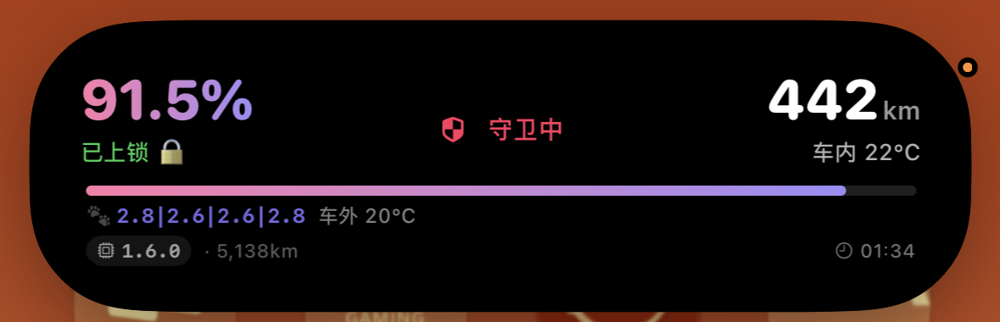
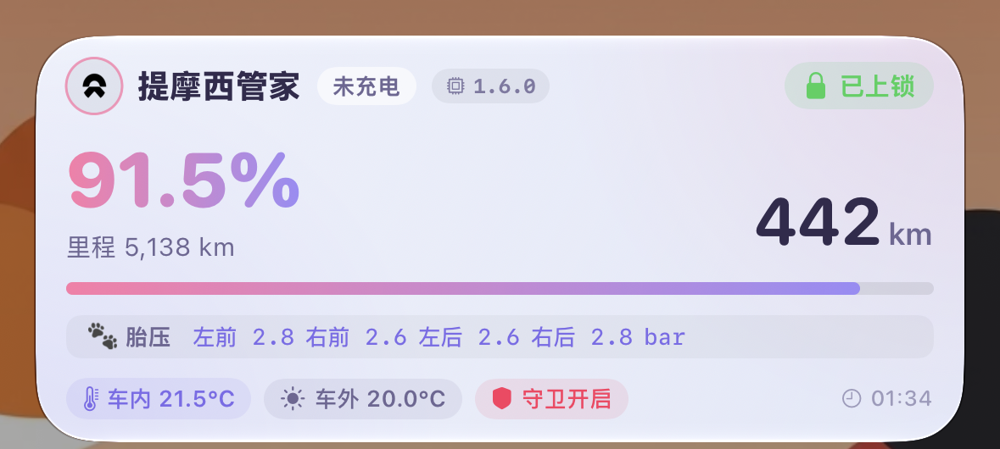
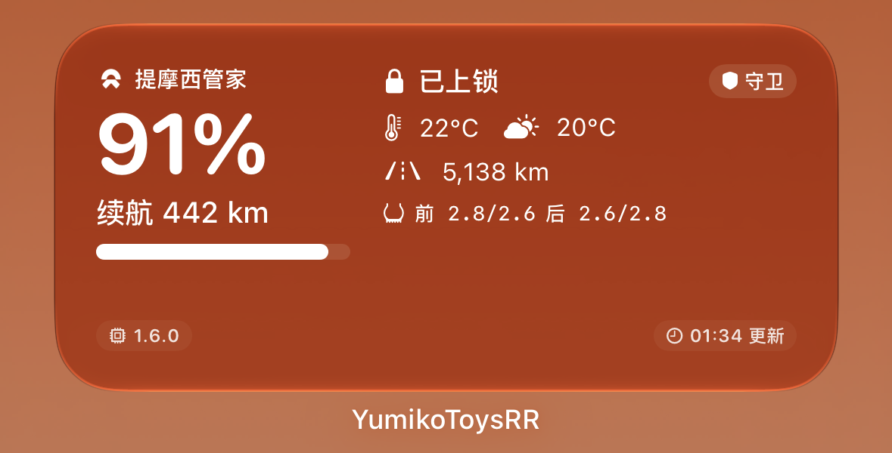
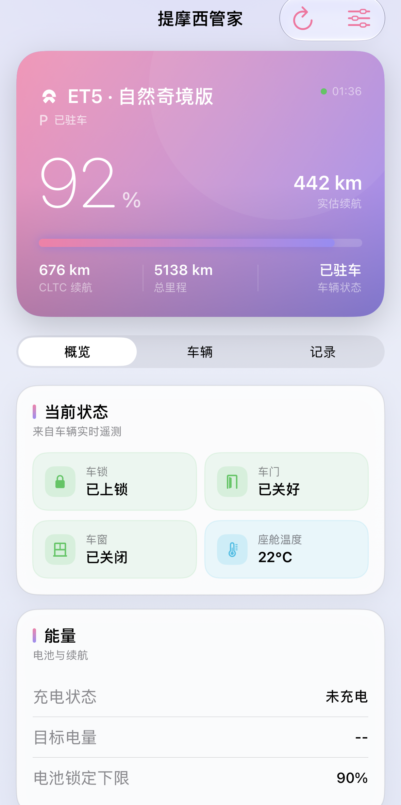
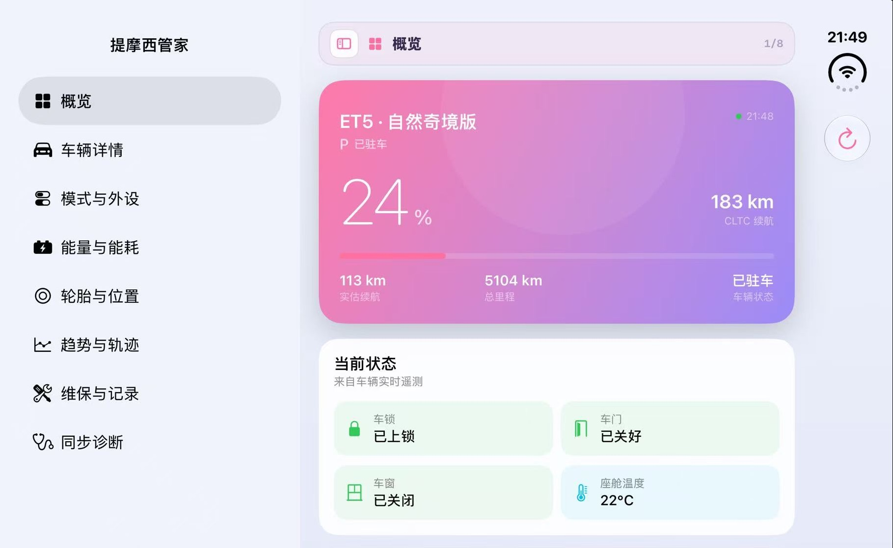
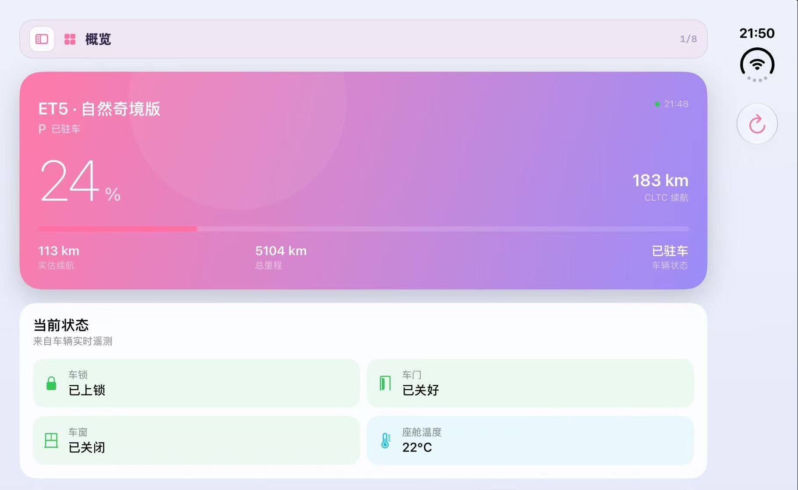
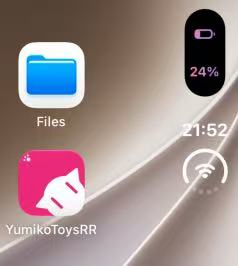
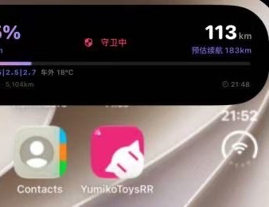

<h1 align="center">🐰 YumikoToysRR for NIO (iOS)</h1>

<p align="center">
  
  <br>
  
  
  <br>
  
</p>

<p align="center">
  <strong>专为蔚来车主打造的二次元萌动艺术风车况看板 · 灵动岛 (Dynamic Island) 与锁屏实时活动 (Live Activity) 智能助理</strong>
</p>

<p align="center">
  
  
  
  
  
  
</p>

---

## ✨ 核心功能矩阵（27 大全景车况与服务系统）

### 1. 🔋 动力电池与高压快充大屏
- **全维高压大电池诊断**：实时剩余电量（SOC）、标称与实估续航里程、总里程、达成率动态能量条。
- **⚡️ 高压快充详情大屏**：实时充电功率（kW）、充电电流（A）、充电电压（V）、目标限充百分比、充满预估时间倒计时、充电桩类型自动辨识（交流慢充 / 直流快充 / 超充桩 / 换电站充电机 / V2L 对外放电）。

### 2. 🪟 车门、车窗与全景天幕透视
- **车门门锁透视**：4 门独立开闭状态、全车防盗锁、前机舱盖、电动尾门、充电口盖状态。
- **车窗与天窗开度**：4 门车窗独立开度百分比（0-100% 动态能量条）、全景天窗天幕开度、后视镜折叠状态感知。

### 3. 🚗 驾驶模式与行车泊车全景
- **驾驶模式全维感知**：舒适、节能、运动、运动+、个性化、雪地、沙地、湿地模式，驻车时智能提示「上次设定模式」。
- **车辆挡位与泊车状态**：实时车速、P/D/R 挡位、遥控泊车辅助（RPA）进行中与待命状态、行程分享状态。

### 4. 🛞 四轮胎压、温度与 12V 小电瓶
- **4 轮胎压与胎温监测**：四轮独立压温网格、冷车推荐气压、胎压告警与休眠智能继承。
- **🔑 智能钥匙与 12V 低压蓄电池**：12V 辅助电瓶实时精准电压（如 `12.8V 优良`）、电瓶健康度评级、蓝牙靠近感应、感应门把手伸出状态。

### 5. 🌡️ 座舱温湿度、舒适与空气健康
- **温暖座舱与空调干燥**：车内外双温差显示、空调运行状态、高温超强干燥、极速除霜、极速冷热、座舱过热保护。
- **🪑 座椅舒适与方向盘加热**：方向盘加热档位、4 座独立加热与通风档位、动力电池预热与保温状态。
- **🧊 车载智能冰箱与空气健康**：车载冰箱电源与当前/目标温度、PM2.5 车内外空气质量检测。
- **📦 储物空间与行李箱状态**：前机舱盖/前备箱开闭、电动尾门/后备箱开闭、中控密码手套箱上锁状态。
- **💡 车外灯光与照明系统**：近光灯、远光灯、示宽灯、双闪危险警报灯拟物化语义展示。

### 6. 📍 高精位置、地图导航与行车轨迹回放
- **高精停车位置与纠偏**：WGS-84 地球坐标转 GCJ-02 高精纠偏，一键调起高德地图 / 百度地图 / Apple 地图导航寻车。
- **🗺️ 历史行驶轨迹地图**：当日行驶轨迹连线渲染、起点终点标记、行驶距离统计与时间轴回放。

### 7. 🛡️ 守卫模式与远程车控
- **特殊驻车模式**：守卫模式（Sentry）、宠物模式、露营模式、离车不下电、车机在线/离线状态。
- **⚡️ 远程智能车控**：闪灯鸣笛寻车、远程开闭空调、车锁解锁/上锁、极速除霜干燥。

### 8. 📑 换电站足迹与财务大屏
- **换电大屏**：累计换电次数、总花费支出、常用换电站 Top 排行榜。
- **服务工单手风琴**：最近换电与维保订单列表，支持一键展开查看服务站地址、工单号、支付明细。

### 9. 📈 能耗达成率与多维趋势图表
- **百公里电耗评分**：达成率动态计算、推算百公里电耗（kWh/100km）能耗评分。
- **🔬 SOC 差值实测电耗**：利用历史快照切分纯行驶段（≥20km、段内无充电/换电 SOC 回升、剔除驻车静态耗电），按「SOC 差 × 电池容量 ÷ 里程」测算真实电耗，近 10 段按里程加权平均，能耗卡「近期实测」一行展示（无有效段时自动隐藏）。
- **📊 趋势图表分析**：每日里程增量柱状图、电池容量衰减健康曲线、历史快照趋势。

### 10. 🔧 维保周期与签到成就
- **维保耗材寿命**：空调滤芯、刹车油、齿轮箱油等耗材寿命倒计时天数与剩余公里数。
- **📅 签到连击**：每日自动签到（9:00 窗口）、连续签到天数统计。

### 11. 🔍 诊断、日志与底层 JSON 检视
- **📜 抓包请求与运行日志**：请求历史列表、URL、状态码、响应耗时（ms）、一键复制 cURL/JSON。
- **底层 JSON 实时检视**：每张卡片右上角配备 `{ }` 按钮，一键弹出查看底层 RVS 数据结构并支持一键复制。

### 12. 🎨 萌系动漫艺术风与个性化
- **车型与涂装定制**：ET5 / ET5T / ET7 / ES6 / EC6 / ES8 / ET9 等各车型与多款官方专属车漆。
- **二次元主题系统**：樱花粉、薄荷青、薰衣草紫、暖阳黄等 6 套主题色，支持粒子特效与省电模式。

### 13. 📱 灵动岛 (Dynamic Island) 与实时活动 (Live Activity)
- 息屏/锁屏即时查看电量、续航、车锁状态、充电功率与充满倒计时；
- 展开区直观呈现 4 轮胎压、车内外温差、车载冰箱、守卫模式告警与车机固件版本胶囊；
- **紧凑岛防裁切适配（v5.1.0）**：左侧纯图标（充电⚡ / 低电橙 / 主题色电量）+ 右侧 SOC 百分比，全机型灵动岛胶囊不再被挖孔截断。

### 14. 🖥️ iPad / Duo 折叠屏全面适配（v5.1.0）
- **特斯拉式侧边栏**：8 大功能分类（概览 / 车辆详情 / 模式与外设 / 能量与能耗 / 轮胎与位置 / 趋势与轨迹 / 维保与记录 / 同步诊断），侧栏底部常驻连接状态；
- **形态自适应**：Duo 折叠态单列手机布局 ↔ 展开态 ≥780pt 自动双列卡片流，看板与设置页均支持；
- **大屏全屏呈现**：设置 / 关于 / 更新日志 / 诊断日志在 regular 宽度用全屏页替代 640pt 死宽 sheet；
- **自定义折叠按钮**：主题色小圆钮 + 淡色标题条，替换系统玻璃大按钮；iPhone 14 Pro 等小屏完全不受影响。

<p align="center">
  
  
  <br>
  
  
  <br>
  <sub>▲ iPhone Duo 实机：侧边栏分栏 / 折叠单列 / 灵动岛实时车况</sub>
</p>

### 15. 🌸 三风格启动动画与主页车图（v5.0.0+）
- **能量充能**（默认）：电池环 0→100% 充能 + 数字滚动 + 电弧凝聚 Logo + 星尘上浮 / 轨道电子 / 冲击波 / Logo 光泽扫过，全套主题联动；
- **像素重制**：15×15 像素点阵波次点亮 → 高清 Logo；**极简快启**：≤1.1s 淡入，省电动效下自动强制；
- 设置页可切换风格 / 节奏 / 每日一次 / 触感反馈，支持一键预览；
- **主页车型图片**：内置 ET5 官图（Vision 原生抠图 + 展台辉光）/ 相册导入 / 纯渐变三模式，标题跟随所选车型。

---

## 📜 更新日志

### v5.7.0 (Build 2815) · 2026-11
- ⌚️ **Apple Watch 腕上速览**：全新 Apple Watch App——SOC 极光环、续航、充电功率与充满倒计时、胎压四宫格、车内外温度、锁车与特殊模式徽章；iPhone 刷新车况后自动推送到手表，抬腕即览；手表不保存任何凭证、不联网请求，主题色跟随 iPhone；已嵌入 iOS 包，在 iPhone 的 Watch App 里一键安装
- 🔬 **SOC 差值实测电耗**：能耗评分卡新增「近期实测」——根据行车前后的电量与里程记录测算真实百公里电耗，自动剔除充电段与驻车耗电，近 10 段按里程加权平均；暂无有效数据时自动隐藏
- ⚡️ **自适应轮询快车道**：行驶中 / 充电中车况自动加快到约 1 分钟刷新，驻车时维持设定间隔，兼顾实时与省电
- 🎨 **主题华丽化**：十套主题渐变 / 强调 / 辉光全面提亮；卡片极光三色标题条 + 顶部虹彩光晕 + 主题辉光投影
- 📖 **版本更新引导页**：首次安装弹出欢迎引导，每个版本更新后首次启动弹出「本版新特性」，每版本只弹一次
- 🛠 **修复**：设备重启后首次打开 App 不再误入「开始配置」空页；Watch App 图标与安装修复
- 📜 仓库新增 MIT LICENSE 文件

### v5.6.0 (Build 2814) · 2026-11
- 🚗 行程数据卡（nio-dash 移植）：最近行程起终点地名、用时 / 里程 / 均速，急加速 / 急减速 / 急转弯仅发生时显示；今日行驶 / 累计里程 / 激活天数三格速览，接口缺数时本地 GPS 采样差值兜底
- 🔋 充电锁定上限修复：对齐 nio-dash 语义直接读 `lock_soc` 展示（用户设定限充优先），能量卡 / 车辆示意图 / CarPlay 限充不再空白
- 📱 锁屏实时活动布局重构：车门 / 车窗未关与胎压告警压缩为底部警示胶囊，未上锁时不再把内容挤出卡片；有告警时自动让位温度与刷新标签
- 🚗 CarPlay / 待机小组件背景兜底：系统会移除 containerBackground，自定义壁纸改画进内容层，车机与待机也能看到背景
- ⌘ 快捷指令：Siri / Shortcuts 支持「刷新车况」（后台拉取 + 播报结果）与「车况速览」（免联网播报电量续航锁车）
- 🗺 主页俯视车况示意图延续 v5.5：可交互部件 + 家充桩充电动画 + 已上锁徽章移至右下角 + 数据更新时间状态点

### v5.2.1 (Build 2810) · 2026-11
- 🖼 小组件 / 锁屏卡片自定义背景全面升级：小 / 中 / 锁屏三个展示位独立裁剪与存储，Vision 智能选区自动框住画面主体，焦点填充按实际容器尺寸自适应取景（任何比例下与裁剪所见一致）
- 🎨 遮罩上帝模式：遮罩风格（跟随主题 / 压暗 / 提亮）+ 起点 / 终点浓度滑条自由调节，文字色调随遮罩明暗自动翻转
- 💾 三个背景保存方案：整套配置（三张裁剪图 + 取景 + 遮罩参数）一键存取切换
- ✂️ 裁剪编辑器：拖动 / 双指缩放选区、手动旋转 90°，修复 Live Photo / HEIC 的 EXIF 方向颠倒
- 🏝 灵动岛 / 锁屏卡片点击深链进 App：立即刷新车况 + 主卡片弹性入场动画 + 触感反馈
- 🌸 全局主题动效层：统一动效曲线 tokens、16 处控件按压手感、主题切换弹簧过渡、看板分区切换动效
- 🔬 诊断页新增「原始数据块查看器」：RVS status 全部数据块语义分组展示、键值复制、一键复制全部 JSON；看板移除暂无法显示的车速行
- 🚀 小火箭模块 v3.3：快捷场景（km/shortcut）请求捕获；RVS 请求自动追加 field=exterior 本地重签
- 🏅 功勋名录新增：夏无隅（电波缪斯·杏坛信使）
- 🩹 修复 Widget 扩展内存峰值导致的背景加载失败（解码缓存限额 + autoreleasepool）；修复配置页横向布局溢出

### v5.2.0 (Build 2809) · 2026-11
- 📥 新增「凭证收件箱」：Shadowrocket 直推的每个字段（车级/用户级 Token、VehicleID、设备指纹…）集中展示，Token 打码显示、点行复制、整包 JSON 复制；收件箱持久化（重启不丢）
- 📤⬇️ 收件箱导出/导入：整包 JSON 存到「文件」App，可从文件导入回填，换机迁移凭证一条龙
- 🚀 Shadowrocket 模块 v3.1：新增用户级 Token 捕获（车控/蓝牙钥匙/RVS 必需）、官方车控指令原文捕获（端点+body）、车机扫码授权链路（poseidon）响应捕获——工程模式扫码的服务端权限判定原文直接抓给你看
- 🧹 智能识别净化：剪贴板/文件导入自动过滤抓包样本字段，只填干净凭证，解析备注可审计
- 🌸 横幅修复：凭证回填从不弹横幅的问题修复；设置页停留也能看到；点击关闭 + 时长加长 + 两行不截断
- 🔐 安全加固：签名密钥移出代码仓库（gitignore 的本地 `NIO_Secrets.plist`），公开仓库不含真实密钥；新环境需在设置页填入
- 🛠 车控与车况修复：充满时间（服务端 ETA）、限充上限误显 90%、行驶车速解码、停车地图实时刷新、灵动岛布局错位与强制下岛自愈、充电口「注意」误报、特殊模式（强化干燥/极速除霜/过热保护）四端显示、省电模式 Widget 预测时间线
- 🎛 车控面板扩至 16 项指令（座垫加热/电池预热/遮阳帘/V2L 放电等）+ WebSocket 实时指令流 + 蓝牙钥匙面板

### v5.1.5 (Build 2807) · 2026-10
- 🏠 新增桌面小组件「蔚来车况」：小 / 中尺寸，电量、续航、充电状态、温度与特殊模式徽章，主题色跟随 App（App Group 快照自动同步）
- 🏝 灵动岛开关胶囊（iOS 18+ 控制中心 / 锁屏）：被强制下岛后一键重新上岛；修复失效引用导致的永久下岛
- 🔋 充电显示修复：充电状态功率兜底判定；充电上限优先 `target_soc_percentage`（用户设定限充），不再误用满电 CLTC 字段
- 🌙 BGTaskScheduler 后台刷新：退后台定期拉取车况并刷新灵动岛 / 实时活动
- 🚗 CarPlay 支持：车况列表 + 全维详情页（限充 / 胎压 / 充电桩类型 / 12V 电瓶），TrollStore 安装自动具备权限（ldid 嵌入）
- 🔔 Token 过期提醒：修复 Token 失效（HTTP 401/403）完全静默——看板顶部红色警示横幅 + 错误触感，「凭证失效」红点点亮，点击直达配置页，重新配置后自动复位；修复 15 分钟降频退避永不生效
- ⚡️ 性能优化：桌面 Widget 仅在车况真实变化时刷新时间线（不再每轮轮询唤醒 Widget 进程）；灵动岛系统活动查询合并降频
- ✨ 启动动画 v5.3「星流汇聚」华丽化：极光漂移背景、向心星流粒子、充能光头、完成瞬间粒子爆发 + 三重冲击波、Logo 3D 入场、主标题逐字上浮；粒子层 Canvas 单层绘制（30fps 上限），华丽但省电

### v5.1.0 (Build 2701) · 2026-10
- 🪞 灵动岛紧凑区重构：左图标 + 右 SOC 数字，适配全机型胶囊宽度
- 📱 Duo 折叠屏与 iPad 全面适配：侧边栏 / 双列 / 全屏页 / 自定义折叠钮
- 🛠 特殊模式识别修复（宠物 / 露营 / 不下电键名对齐真实 RVS）、外设卡语义化、位置卡叠印修复
- 🖼 主页车型标题跟随设置 + Vision 抠图车图展台光
- 🔑 统一设备指纹（User-Guid / app_ver / UA），防服务器多端误判踢线；抓包链路全同步
- 🔁 凭证接收去重：相同凭证重复推送静默忽略，不再反复震动

### v5.0.0 (Build 2700) · 2026-10
- 🚀 iOS 26 基线（部署目标 16.1 → 26.0）
- 🌸 三风格启动动画（能量充能 / 像素重制 / 极简快启）+ 设置项
- 📊 看板六张新卡：特殊模式、智能外设、能耗评分、历史趋势（Swift Charts）、维保追踪、今日行驶轨迹（MapPolyline）
- 📦 换电/维保订单本地持久化，冷启动即有数据；空响应保护，接口抖动不清屏

---

## 🔄 双引擎数据获取

App 支持两种数据来源，可单独使用，也可同时开启互补：

| | 模式 A：抓包回放模式 | 模式 B：动态签名模式 |
|---|---|---|
| 数据来源 | 蔚来 App 全量车况接口 | 小组件轻量接口 |
| 数据丰富度 | ⭐⭐⭐ 全部深度状态块（12V 电瓶 / 座椅加热 / 车窗开度 / 冰箱 / 灯光等） | ⭐⭐ 核心基础块（电量 / 续航 / 车锁 / 位置 / 胎压） |
| 凭证获取 | 蔚来 App 刷新一次自动抓取 | 手动填 Vehicle ID / Device ID / 签名密钥 |
| Token 保鲜 | 蔚来 App 刷新即自动续新，无感续命 | 动态计算签名，永不过期 |

两种模式同时开启时，智能数据继承引擎会自动融合：动态签名模式缺少的深度数据块，自动无缝使用抓包模式缓存的最新有效数据，任何卡片都绝不空白。

---

## 📱 凭证抓包与配置指引（三条链路，全部支持自动回填）

> 🔑 **防多端登录踢 Token（v5.1.0）**：三条链路均自动捕获设备指纹（`User-Guid` / `app_ver` / `User-Agent`），
> App 回放五类请求时与真机同源，服务器不再把回放判定为多端登录。UA 策略：主 App 指纹优先，Widget 指纹仅兜底。

### 链路一：Shadowrocket 模块直推（推荐日常使用）
1. 添加模块 `scripts/shadowrocket/YumikoToys-NIO.sgmodule`（v3.1.0+，模块详情可查看 `#!version` 确认最新），开启 HTTPS 解密（MITM）；
2. iPhone 上打开 YumikoToys → 设置 → 蔚来看板 → 开启 **TCP 转发**（监听 127.0.0.1:8997）；
3. 打开 **蔚来 App** 下拉刷新一次——小火箭自动捕获 Token / 车辆 ID / 设备指纹并**直推回填**，App 弹「已回填」即完成；
4. Token 过期时（蔚来 App 刷新一次）会自动推送新 Token，**无感续命**；相同凭证重复推送会被 App 静默去重，不反复震动；
5. **📥 凭证收件箱**（设置 → 蔚来看板 → 凭证收件箱）：直推的每个字段与抓包样本集中展示、打码/复制/导出；导出的 JSON 可在换机后一键导入回填。

#### v3.1 模块捕获能力（安全研究向）
| 捕获项 | 触发方式 | 去处 |
|---|---|---|
| 车级 Token / VehicleID / 设备指纹 | 蔚来 App 下拉刷新 | 自动回填 + 收件箱 |
| **用户级 Token**（车控/钥匙/RVS 必需） | 蔚来 App 任意主界面请求 | 自动回填（优先使用） |
| **官方车控指令原文**（端点 + body） | 在蔚来 App 点任意车控按钮 | 收件箱「🎯 车控样本」+ 诊断日志 |
| **扫码授权链路响应原文**（poseidon） | 用蔚来 App 扫车机二维码（含工程模式） | 收件箱「🔬 扫码样本」+ 诊断日志 |

### 链路二：Mac 抓包助手 sniff.sh（备胎 / 全量 JSON）
1. Mac 运行 `./sniff.sh iphone`（需 `brew install mitmproxy`），按提示给 iPhone 配 Wi-Fi 代理 8080 并信任 mitmproxy 证书；
2. iPhone 上先开 YumikoToys 的 TCP 转发并保持前台，再打开蔚来 App 下拉刷新；
3. 抓到核心凭证后**自动直推回 iPhone**（与链路一同协议），JSON 同时落盘 `nio_sniff_result.json` 并复制剪贴板；
4. 直推失败时，把剪贴板 JSON 直接粘进 App「⚡️ 智能填充」——自动清洗反引号 / 伪 token 数组等杂质（并自动过滤抓包样本字段）；也可以把落盘的 `nio_sniff_result.json` 通过收件箱「导入」一键回填。

### 链路三：Widget 动态签名模式（免抓包长期模式）
1. 在 App 设置中填入 **Vehicle ID**、**Device ID** 与 **Sign Secret**；
2. 应用每次请求动态计算 MD5 时间戳签名，**永不过期**，适合不想频繁抓包的场景（数据块比 RVS 全量模式少，缺失块自动继承本地缓存）。

### Token 捕获差异速查
| 字段 | Shadowrocket | sniff.sh (mitmproxy) |
|---|---|---|
| Token / 车辆 ID / device_id / sign / RVS URL | ✅ | ✅ |
| 设备指纹三件套（app_ver / UA / User-Guid） | ✅ | ✅ |
| 用户级 Token（车控/钥匙/RVS，v3.1+） | ✅ | ✅ |
| 官方车控指令原文 / poseidon 扫码链路（v3.1+） | ✅ | ❌ |
| 换电 / 签到接口 | ✅ | ✅ |
| refresh_token / sign_secret / Token 续期（响应体） | ❌（请求型脚本无响应体） | ✅ |

> SR 链路自洽：refresh_token App 不使用；sign_secret 仅 Widget 动态签名模式需要（可手动填写或跑一次 sniff.sh 补上）；Token 续期由「蔚来 App 刷新 → SR 抓新 Token → 直推」完成。

---

## 📦 安装说明 (Installation)

### 方式一：下载 Release 预编译 IPA（推荐）
1. 前往 GitHub [Releases](../../releases) 页面，下载最新的 `YumikoToysRR-unsigned.ipa`；
2. 使用 **TrollStore（巨魔商店）**、**Sideloadly**、**AltStore** 或个人证书直接签名安装；
3. 自带灵动岛与锁屏实时活动扩展插件 (`WheaterStatusExtension.appex`)。

### 方式二：Xcode 源码编译
1. 克隆本仓库：
   ```bash
   git clone https://github.com/kissggj123/NIO-Dash-iOS.git
   cd NIO-Dash-iOS
   ```
2. 使用 Xcode 打开 `YumikoToysRR.xcodeproj`；
3. 在 `Signing & Capabilities` 中配置您的开发者账号证书，选择真机运行安装即可；
4. 🔐 **签名密钥**：克隆构建后请在 App 设置页填入签名密钥，否则 Widget 动态签名模式无法签名。

---

## 🌲 项目结构 (Directory Tree)

```text
YumikoToysRR-Weather/
├── WheaterStatus/                      # 灵动岛 / 锁屏 / 桌面小组件 / 控制中心 Widget 扩展
│   ├── WheaterStatus.swift             # 实时活动 UI 渲染（紧凑岛、展开岛、锁屏大卡片）
│   ├── NIOHomeWidgets.swift            # 桌面系统小组件（小 / 中尺寸）
│   ├── IslandControlWidget.swift       # 控制中心控件（一键上岛胶囊）
│   ├── NIOVehicleSnapshot.swift        # App ↔ Widget 跨进程车况快照（App Group）
│   ├── WheaterStatus.intentdefinition  # WidgetKit 意图配置
│   └── Assets.xcassets                 # 小组件专属素材与颜色令牌
├── WheaterWatch/                       # Apple Watch 腕上速览
│   ├── WheaterWatchApp.swift           # watch App 入口
│   ├── WatchDashboardView.swift        # 腕上看板（SOC 极光环 / 徽章 / 胎压宫格 / 温度）
│   ├── WatchSession.swift              # 快照接收（iPhone 自动推送）
│   ├── WatchSnapshot.swift             # 快照模型
│   └── WatchTheme.swift                # watch 端主题色（跟随 iPhone 主题）
├── wheater/                            # iOS 主应用程序源码
│   ├── Model/NIO/                      # 数据模型与核心算法库
│   │   ├── NIOModels.swift             # 蔚来 API 数据结构定义（SOC/车门/空调/胎压/维保/充电等）
│   │   ├── NIOVehicleLib.swift         # 电池容量推算、坐标纠偏、能耗评分、动态签名与主题令牌
│   │   ├── NIOOrderLib.swift           # 换电/维保订单账单与常用换电站排行解析
│   │   └── NIOCheckinLib.swift         # 车主每日签到与连签统计
│   ├── Model/WheaterAttributes.swift   # 跨进程 Live Activity 数据契约与指纹去重
│   ├── ViewModel/
│   │   └── NIOService.swift            # 双引擎通信、数据继承融合、自适应轮询、灵动岛生命周期
│   ├── Services/VPN/                   # 抓包凭证链路
│   │   ├── NIOVPNManager.swift         # 抓包 VPN 生命周期管理
│   │   ├── NIOMitmEngine.swift         # 本地代理引擎（指纹嗅探与流量中继）
│   │   ├── NIOVPNCertManager.swift     # CA 证书本地分发
│   │   └── NIOCredentialReceiver.swift # 局域网凭证直推接收器
│   ├── Views/NIO/                      # SwiftUI 视图层
│   │   ├── IOSNIODashboardView.swift   # 全景车况主看板（iPhone 分段器 / iPad·Duo 侧栏双列）
│   │   ├── NIODashboardCards.swift     # 特殊模式 / 外设 / 能耗评分 / 趋势 / 维保 / 轨迹等卡片
│   │   ├── NIOSchematicCarView.swift   # 主页俯视车况示意图（可交互部件 + 充电动画）
│   │   ├── IOSNIOConfigView.swift      # 凭证配置、智能填充、抓包日志、连通性测试
│   │   ├── NIOCredentialInboxView.swift# 凭证收件箱（打码 / 复制 / 导出 / 导入）
│   │   ├── NIOConfigBackupView.swift   # 凭证配置备份与恢复
│   │   ├── NIOReleaseOnboardingView.swift # 版本更新引导页
│   │   ├── NIOCarPlayScene.swift       # CarPlay 场景与车况列表
│   │   ├── IOSAboutView.swift          # 关于页与版本更新日志
│   │   ├── NIODatingLabView.swift      # 约会实验室（题目 / 理论卡片 / 心愿库）
│   │   ├── NIODating*.swift            # 约会实验室数据模型 / 36 问题库 / 心愿保险箱
│   │   ├── NIOLaunchStyle.swift        # 启动风格枚举 / 节奏 / 每日一次闸门
│   │   ├── NIOEnergyBootView.swift     # 能量充能启动动画
│   │   ├── NIOPixelLaunchSplashView.swift # 像素重制启动动画
│   │   └── NIOMinimalBootView.swift    # 极简快启动画
│   ├── ContentView.swift               # App 根路由与全局主题上下文
│   ├── wheaterApp.swift                # 应用主入口
│   ├── Resources/                      # 静态资源（品牌 Logo / 10 款车型渲染图与车色库）
│   └── wheater.entitlements            # App Group 与后台刷新权限声明
├── docs/screenshots/                   # README 展示截图
├── auto_sniff.py                       # Mac 抓包脚本（指纹捕获 + 局域网直推回 iPhone）
├── sniff.sh                            # Mac 一键抓包启动器
├── scripts/
│   ├── shadowrocket/                   # Shadowrocket 模块与脚本
│   ├── boxjs/                          # BoxJS 抓包配置脚本
│   ├── ish/                            # iSH 环境抓包脚本
│   ├── sniff_3d_model.py               # 车型渲染图素材抓包脚本
│   └── sniff_3d_model.sh               # 车型素材抓包启动器
├── dating-lab-psychology/              # 约会实验室心理学题目与理论研究资料
└── YumikoToysRR.xcodeproj              # Xcode 工程（App + Widget 扩展 + Watch App 多 Target）
```

---

## 🛠️ 技术架构

- **UI 渲染**：SwiftUI（100% 声明式原生组件，支持 120 FPS 高刷 ProMotion）
- **实时活动**：ActivityKit + WidgetKit
- **架构模式**：MVVM + Clean Architecture 分层架构
- **数据保活与继承**：7 大状态块异步落盘与自适应指纹对比算法

---

## 🙏 致谢与灵感来源 (Acknowledgements)

本项目在接口逆向、数据结构设计与车况监控逻辑上深受以下优秀的开源项目启发，在此致以诚挚的感谢：

- [real3841/NIO-Dash](https://github.com/real3841/NIO-Dash) - 优秀的蔚来车况仪表板与数据可视化方案
- [genelee26/ha-nio](https://github.com/genelee26/ha-nio) - 蔚来车辆 Home Assistant 集成插件与 API 协议参考

---

## 📄 开源许可证

本项目基于 [MIT License](LICENSE) 协议开源。
